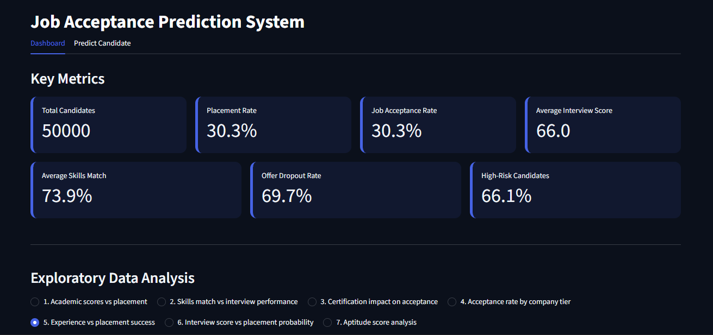

# Job Acceptance Prediction System

An end-to-end machine learning project that predicts whether a job candidate will be placed (accept an offer), using Python, MySQL, scikit-learn, Power BI and Streamlit.

## Overview

This project analyses 50,000 candidate records covering academic scores, interview performance, skills match, experience, salary expectations and job details. A Gradient Boosting model estimates each candidate's acceptance probability, and a Streamlit dashboard lets recruiters explore the data and predict outcomes for new candidates.

**Workflow:** Raw CSV → Data Cleaning & Feature Engineering (Python) → MySQL Database → Cleaned CSV → Exploratory Data Analysis (Power BI) → Model Training (scikit-learn) → Streamlit Dashboard.

## Features

- Clean and prepare data using Pandas (imputation, text standardisation, duplicate removal)
- Create derived features such as experience category, academic band and interview performance
- Store cleaned data in MySQL
- Compare five classification models with 5-fold cross-validation
- Tune the decision threshold using out-of-fold predictions
- Explore trends through 7 EDA charts, each with a written takeaway
- Predict job acceptance for a new candidate and see the probability on an acceptance meter

## Tech Stack

| Area | Tools |
|---|---|
| Programming | Python, SQL |
| Data analysis | Pandas, NumPy |
| Machine learning | scikit-learn, joblib |
| Database | MySQL, SQLAlchemy, PyMySQL |
| EDA charts | Microsoft Power BI |
| Dashboard | Streamlit, custom CSS |
| Tools | Jupyter Notebook, VS Code |

## Project Structure

```text
Job-Acceptance-Prediction-System/
├── .streamlit/
│   └── config.toml                  # Streamlit theme
├── images/                          # EDA chart images used by the dashboard
│   ├── eda_1_academic.png
│   ├── eda_2_skills_interview.png
│   ├── eda_3_certifications.png
│   ├── eda_4_company_tier.png
│   ├── eda_5_experience.png
│   ├── eda_6_interview.png
│   └── eda_7_aptitude.png
├── screenshots/
│   └── dashboard_overview.png       # add your dashboard screenshot here
├── dashboard.py                     # Streamlit dashboard
├── job_acceptance_system.py         # cleaning, SQL load and model training
├── style.css                        # dashboard styling
├── HR_Job_Placement_Dataset.csv     # raw dataset
├── Cleaned_Dataset.csv              # cleaned dataset
├── job_acceptance_model.pkl         # trained model and threshold
├── EDA_Report_Job_Acceptance.docx   # written EDA report
├── requirements.txt
└── README.md
```

## Getting Started

### Prerequisites

- Python 3.11+
- MySQL Server (only needed if you re-run the training script)

### Installation

```bash
git clone https://github.com/Makesh-P/Job-Acceptance-Prediction-System.git
cd Job-Acceptance-Prediction-System
python -m pip install -r requirements.txt
```

`scikit-learn` is pinned to the version used to train the saved model, because pickled models can fail to load on other versions.

### Run the dashboard

The trained model and cleaned dataset are included, so you can start the dashboard straight away:

```bash
streamlit run dashboard.py
```

Run the command from the project folder so Streamlit finds the `.streamlit` theme folder.

### Re-train the model (optional)

1. Keep `HR_Job_Placement_Dataset.csv` in the project folder, or update its path in `job_acceptance_system.py`.
2. Replace `your_password` with your local MySQL password in `job_acceptance_system.py` (it appears twice). Do not commit passwords to GitHub.
3. Run the script to clean the data, load it into the `job_acceptance_db` database (table `candidates`), write `Cleaned_Dataset.csv`, train the model and save `job_acceptance_model.pkl`:

   ```bash
   python job_acceptance_system.py
   ```

4. Start the dashboard with `streamlit run dashboard.py`.

## Data Cleaning & Feature Engineering

The raw dataset has 51,500 rows and 26 columns. The cleaning process fills missing numerical values (SSC percentage, HSC percentage, employment gap, notice period) with the median, fills missing categorical values (career switch willingness, relevant experience, job role match, layoff history, relocation willingness) with the mode, standardises text with trimming and title case, and removes duplicates. The cleaned dataset has 50,000 rows and 32 columns, and creates these derived fields:

| Column | Definition |
|---|---|
| `status_flag` | 1 if the candidate is Placed, otherwise 0 (target variable) |
| `Experience_category` | Fresher (≤1 year), Junior (≤3 years), or Senior (>3 years) |
| `Academic_band` | Average (<65), Good (65–74), or Excellent (75+) based on degree percentage |
| `Skills_match` | Low (<60), Medium (60–79), or High (80+) based on skills match percentage |
| `interview_avg` | Average of technical, aptitude and communication scores |
| `Interview_performance` | Developing (<60), Proficient (60–69), or Outstanding (70+) |

## Model

The model uses 25 input features. Categorical fields are encoded (ordinal encoding for binary and tiered fields, one-hot encoding for degree specialization) and numeric fields are scaled, all inside a single scikit-learn pipeline.

- **Models compared:** Logistic Regression, KNN, Decision Tree, Random Forest and Gradient Boosting, using 5-fold stratified cross-validation (accuracy, F1, ROC-AUC).
- **Selected model:** Gradient Boosting Classifier.
- **Threshold:** thresholds from 0.30 to 0.70 were compared on out-of-fold precision, recall and F1, and **0.40** was chosen.
- **Split:** 80% training and 20% testing, stratified, `random_state=42`.

Test-set performance at the 0.40 threshold:

| Metric | Score |
|---|---|
| Accuracy | 89.31% |
| Precision | 78.92% |
| Recall | 88.24% |
| F1 Score | 83.32% |
| ROC-AUC | 0.9612 |

## Exploratory Data Analysis

EDA charts were built in Power BI and exported as images for the dashboard. They cover academic scores, skills match versus interview performance, certifications, company tier, experience, interview score versus predicted probability, and aptitude score distribution. The full written analysis is in `EDA_Report_Job_Acceptance.docx`.

## Dashboard

The Streamlit app has two tabs:

- **Dashboard:** 7 KPI cards (total candidates, placement rate, job acceptance rate, average interview score, average skills match, offer dropout rate and high-risk candidates) and an EDA section with a chart selector and a key takeaway for each chart.
- **Predict Candidate:** a five-step form (personal, skills, experience, job, preferences) that returns the acceptance probability on a meter, along with a table of the data used for the prediction.

The theme is set in `.streamlit/config.toml`, and the custom styling is in `style.css`.

## Dashboard Preview



*Add your dashboard screenshot to the `screenshots` folder and make sure the filename matches the path above.*

## Key Findings

- About 30% of candidates are placed (15,130 of 50,000), so the classes are imbalanced and the project uses stratified splits and threshold tuning.
- Experience shows the clearest pattern: acceptance rates rise from 18.69% for freshers to 41.21% for juniors and 59.75% for seniors.
- Academic scores (SSC, HSC and degree percentage) are almost the same for placed and not-placed candidates.
- Company tier makes little difference, with acceptance rates of 29.94%, 30.42% and 30.54% across the three tiers.
- The number of certifications does not give a consistent increase in acceptance rate.
- Higher interview scores appear more often among placed candidates, but skills match alone does not determine placement.

## Recommendations

- Prioritise interview performance and experience over academic percentages or certification count when screening candidates.
- Use the predicted probability to follow up early with candidates below the threshold, who are flagged as high risk.
- Revisit the 0.40 threshold if wrongly flagging candidates costs more than missing them, since the current setting favours recall.

## Author

**Makesh P**

[LinkedIn](https://www.linkedin.com/in/makesh-p-54759b2a9) | [GitHub](https://github.com/Makesh-P)
